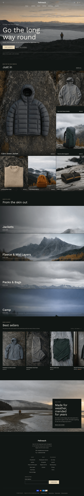

# Estuary

Estuary is a free storefront theme for **Wave**, the Swell storefront app with a visual editor and an AI agent. It is image-led: large photographs set edge to edge on a deep, quiet background, with small, calm type. It fits any kind of store with good photos.

- Listing copy (the Swell Theme Store page): [`DESCRIPTION.md`](DESCRIPTION.md)
- The installable theme app: [`app/`](app)

## Using it

1. Install Estuary from the Swell Theme Store. It is free.
2. Customize it in the Wave editor: click any section or line of text to change it, set fonts, colors, spacing and Estuary's own settings in the Theme tab, or ask the AI agent for a change in plain words.
3. Publish when it's ready. Until then every change stays a draft.

Estuary reads the store's own Swell data (products, categories, menus, the blog and store details), so set those up in the Swell dashboard first. Shoppers check out on Swell's hosted checkout.

## What's inside

Estuary is the image-led one of Swell's free themes; it changes the look, not the store's structure. Its own sections:

- `photo_cover`: the home page opening: a screen-high photo with words set low over it (a chosen product's photo until one is set)
- `photo_grid`: products as a wall of photos, the first optionally twice the size; on collection pages, the count, sort, folded filters and pages
- `category_panels`: categories as tall photographs side by side, or as wide bands
- `photo_reel`: a sideways reel of products, by touch, trackpad or keyboard
- `image_note`: one wide photo with a short note pinned over its corner
- `collection_cover`: a category's opening on its own image
- `product_stage`: the product page: the photo across the screen, a buy panel over its edge, the other photos two to a row

Its own templates are home, product, collection and cart; its own Header group sits over the home page's opening photo, and its Footer group carries a newsletter sign-up. Its theme settings (`theme/config/settings_content.json`) cover: a sticky header; product names over or under the photo; the second photo on hover; an add button under each product; how the product page's large photo fits. Its colors, fonts and style choices are in `theme/config/settings.json`.

## How it's built

Estuary is built on Swell's shared theme core, like every Wave theme. The core provides the sections every theme has (header, footer, cart, account, search, blog, policies and the rest) and Store text, and every theme must show a Header and a Footer group on every page; Estuary adds its own sections, templates, settings and design over it. `app/` is the assembled theme, built from the core and the files here; change Estuary's own files and rebuild it, never edit `app/` by hand.

How a section is written, the repository layout and how a theme is assembled are the same for every theme on the core: see the README of Tide, Swell's first free theme.

## License

Estuary is licensed under the Swell App License (`LICENSE`), which covers this repository, the shared theme core in `app/` included.
